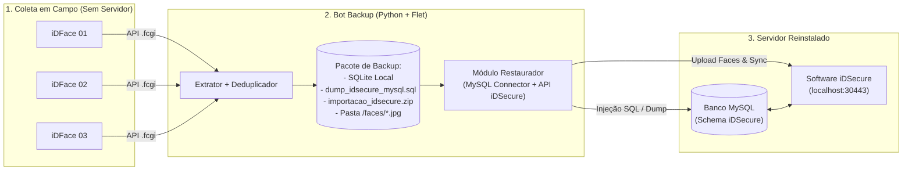

# PRD: Bot de Backup e Recuperação de Desastres para Control iD (iDFace)

**Versão:** 1.0  
**Data:** 16 de Outubro de 2026  
**Status:** Rascunho Inicial (Aguardando Revisão)  
**Foco:** Extração de dados de controle de acesso diretamente dos terminais faciais (iDFace / linha iDAccess) em cenários de perda total do servidor (Disaster Recovery).

---

## 1. Visão Geral e Contexto do Problema

### 1.1 O Problema
Em clientes que utilizam catracas ou portas controladas por leitores faciais da **Control iD (iDFace)** integrados a um servidor local, falhas críticas de hardware no servidor (como queima de disco rígido/SSD, corrupção de banco de dados ou ransomware) sem rotina de backup em nuvem resultam na **perda total da base de cadastros**. Recadastrar centenas ou milhares de usuários, coletar fotos faciais novamente e reconfigurar cartões/regras gera alto custo operacional, filas na recepção e insatisfação grave do cliente.

### 1.2 A Oportunidade (Solução)
Como os equipamentos **iDFace** operam em modo *standalone* ou sincronizado mantendo uma cópia local em sua memória interna (banco SQLite embarcado acessível via API HTTP/REST da própria Control iD), é possível **engenharia reversa do fluxo de sincronização**: em vez do servidor enviar dados para os equipamentos, o nosso **Bot de Backup** varre a rede local, autentica nos equipamentos sobreviventes, extrai todos os cadastros, fotos faciais, credenciais e regras de acesso, **consolida/deduplica** os dados de múltiplos leitores e gera um pacote de backup fiel à estrutura da API da Control iD (Banco SQLite + JSON + Imagens).

---

## 2. Objetivos do Produto

1. **Recuperação Rápida em Campo:** Permitir que um técnico conecte seu notebook na mesma rede dos equipamentos iDFace e extraia 100% da base de usuários e regras em poucos minutos.
2. **Descoberta e Extração Multi-Equipamento:** Suportar ambientes com 1 ou mais iDFaces (ex.: 4 catracas de entrada/saída), varrendo faixas de IP e unificando os cadastros sem duplicar usuários.
3. **Fidelidade Estrutural à API Control iD e Compatibilidade Direta com iDSecure (MySQL):** Salvar os dados localmente (SQLite + JSON + Fotos) **e também** disponibilizar a exportação/injeção direta para **MySQL** (padrão utilizado pelo servidor **iDSecure On-Premises**), além de gerar o pacote `.zip` oficial de importação do iDSecure e suportar injeção via API do iDSecure (`https://localhost:30443/api/...`) quando o servidor for reinstalado.
4. **Resiliência de Rede:** Extrair fotos faciais (que são pesadas e transferidas via requisições individuais ou em lote) com controle de concorrência, *retry* automático e retomada em caso de queda temporária de conexão com a catraca.

---

## 3. Público-Alvo (Personas)

* **Técnico de Suporte / Implantação em Campo:** Precisa de uma interface visual simples (Desktop em Python + Flet), onde baste digitar a faixa de IP (ou lista de IPs), informar o login/senha padrão dos equipamentos (`admin` / `admin`), extrair os dados das catracas e, após formatar/reinstalar o servidor Windows com **iDSecure + MySQL**, apontar o backup para repopular todo o servidor rapidamente.

---

## 4. Escopo de Dados a Extrair (API iDFace)

O bot fará chamadas autenticadas (`POST /login.fcgi`) e utilizará os endpoints nativos de listagem (`POST /load_objects.fcgi` e endpoints de imagem) para extrair:

### 4.1 Cadastros de Usuários (`users`)
* `id` (ID interno do usuário no equipamento — mapeado como `idDevice` no banco MySQL do iDSecure)
* `registration` (Matrícula / identificador externo)
* `name` (Nome completo)
* `password` e `salt` (Senha numérica de acesso/coação, quando houver)
* `expires`, `begin_time`, `end_time` (Validade do cadastro / visitantes ou temporários)
* `user_type_id` (Tipo de usuário: Pessoa vs. Visitante -> `idType` no iDSecure)
* Metadados customizados ou documentos (CPF/PIS quando armazenados em `registration` ou campos auxiliares)

### 4.2 Fotos / Templates Faciais (`user_images`)
* Listagem de usuários que possuem foto cadastrada (`POST /user_list_images.fcgi` ou flag de imagem).
* Download da foto facial original (`GET/POST /user_get_image.fcgi?user_id=X`) em formato binário (`.jpg`) e/ou Base64.
* *Nota Técnica:* O iDFace gera o template biométrico (vetor matemático) a partir da foto JPG quando ela é enviada via `user_set_image.fcgi`. Portanto, recuperar a imagem JPG original garante 100% de compatibilidade para reenviar a face para o novo servidor iDSecure e para novos iDFaces.

### 4.3 Credenciais Extras (`cards`, `pins`, `qrcodes`)
* **Cartões (`cards`):** `id`, `value` (código numérico / Wiegand calculado -> `code` e `value` na tabela `Cards` do MySQL iDSecure), `user_id`, `type`.
* **Senhas (`pins`) / QR Codes (`qrcodes`):** Vínculos de códigos de acesso secundários atrelados ao `user_id`.

### 4.4 Grupos, Departamentos, Horários e Regras de Acesso
Para reconstruir toda a inteligência de quem pode acessar qual catraca e em qual horário (mapeando da estrutura `.fcgi` do aparelho para as tabelas `Groups`, `UserGroups`, `Scheduls`, `AccessRules`, `Areas` e `Devices` do MySQL no iDSecure):
* `groups` / `departments` (Grupos ou departamentos cadastrados)
* `user_groups` (Relacionamento N:N entre usuários e grupos)
* `time_zones` e `time_spans` (Tabelas de horários e faixas de permissão por dia da semana/feriados -> `Scheduls` no iDSecure)
* `access_rules` (Regras de acesso e seus tipos/prioridades -> `AccessRules` no iDSecure)
* `group_access_rules` e `user_access_rules` (Vínculo de regras com grupos e usuários)
* `access_rule_time_zones` (Vínculo de regras com horários -> `SchedulAccessRules`)
* `portal_access_rules` (Vínculo com portais/relés)
* `holidays` (Feriados configurados)

*(Fora de escopo nesta versão: Logs históricos de giro/acesso `access_logs`).*

---

## 5. Requisitos Funcionais (RF)

| ID | Requisito | Descrição | Prioridade |
| :--- | :--- | :--- | :--- |
| **RF01** | **Descoberta e Conexão Multi-IP** | Permitir inserir um IP único (`192.168.1.100`), uma lista de IPs ou uma faixa de IP (`192.168.1.1` a `192.168.1.254`) com porta customizável (padrão `80` ou `443`). O bot deve testar a conectividade e identificar quais IPs respondem como dispositivos Control iD. | Alta |
| **RF02** | **Autenticação nos Terminais** | Permitir configurar credenciais globais (ex: `admin`/`admin`) e também credenciais específicas por dispositivo caso algum iDFace tenha senha diferente. Gerenciar a `session` retornada pelo `/login.fcgi` e renová-la automaticamente se expirar durante extrações longas. | Alta |
| **RF03** | **Extração Paginada de Objetos** | Consultar `/load_objects.fcgi` para todas as tabelas do escopo. Caso o equipamento possua milhares de registros, realizar paginação (`limit` e `offset`) para não estourar a memória RAM do iDFace nem causar *timeout* HTTP. | Alta |
| **RF04** | **Extração Resiliente de Fotos Faciais** | Baixar as fotos faciais de cada usuário com controle de *throttling* (ex: máximo de 2 a 5 requisições simultâneas por aparelho) para não travar o processador do iDFace enquanto pessoas passam na catraca. Implementar *retry* (3 tentativas) em caso de falha. | Alta |
| **RF05** | **Consolidação e Deduplicação Multi-Equipamento** | Quando múltiplos iDFaces forem lidos, o bot deve manter os dados brutos de cada equipamento separados por origem (`device_ip` / `device_id`) **E** gerar uma **Base Consolidada (Unificada)**, mesclando usuários pelo `id` + `registration` + `name` (mantendo a foto facial mais recente/válida caso um equipamento tenha foto e outro não). | Alta |
| **RF06** | **Exportação Multi-Formato (SQLite + Dump MySQL + JSON + Pacote iDSecure)** | Ao finalizar, gerar um pacote de backup contendo: 1. `backup_controlid.sqlite`: Banco local embarcado. 2. `dump_idsecure_mysql.sql`: Script SQL completo compatível com o schema MySQL do **iDSecure** (`Users`, `Cards`, `Groups`, `UserGroups`, `AccessRules`, `Scheduls`, `Devices`). 3. `importacao_idsecure.zip`: Planilha CSV/XLSX + Fotos formatadas no padrão nativo de importação web do iDSecure. 4. `backup_full.json` e pasta `/faces/`. | Alta |
| **RF07** | **Módulo de Restauração / Injeção para iDSecure (MySQL & API)** | Permitir apontar um backup salvo para o novo servidor recém-instalado através de 2 modos: • **Conexão Direta MySQL:** Informar `Host`, `Porta (3306)`, `User`, `Password` e `Database (idsecure)` para popular as tabelas diretamente no MySQL. • **Sincronização via API iDSecure / pacote Web:** Enviar os cadastros, cartões, grupos e fotos faciais via API local do iDSecure (`https://localhost:30443/api/...`) ou pacote de importação, garantindo que o iDSecure gere todos os hashes internos e reconheça as fotos imediatamente. | Alta |
| **RF08** | **Interface Gráfica Desktop (Python + Flet)** | Interface intuitiva em abas/etapas: • **Aba 1 (Extração iDFace):** Descoberta de IPs, seleção de catracas, progresso em tempo real e geração do backup. • **Aba 2 (Restauração iDSecure / MySQL):** Seleção de um backup existente, configuração do MySQL / iDSecure destino e botão para restaurar os dados no servidor novo. | Alta |
| **RF09** | **Retomada de Backup (Checkpoint)** | Gravar os dados no banco SQLite local incrementalmente à medida que são extraídos. Se o cabo de rede desconectar na foto 1.500 de 3.000, ao clicar em "Retomar", o bot pula as 1.500 fotos já salvas e continua da 1.501. | Média |
| **RF10** | **Relatório de Auditoria do Backup** | Exibir ao final um resumo: Total de equipamentos lidos, Total de usuários únicos recuperados, Total de usuários com foto vs. sem foto, Total de cartões e grupos recuperados, e eventuais divergências entre catracas. | Média |

---

## 6. Requisitos Não-Funcionais (RNF)

* **RNF01 - Segurança Operacional (Não-Disruptivo nas Catracas):** Durante a etapa de backup, o bot deve operar estritamente em modo **Somente Leitura (Read-Only)** nos equipamentos iDFace de origem.
* **RNF02 - Baixo Impacto de Performance na Catraca:** O iDFace possui hardware embarcado limitado. As chamadas de API devem respeitar um intervalo seguro (configurável, ex: `50ms` a `200ms` entre downloads de fotos) para que o reconhecimento facial ao vivo na recepção do cliente não fique lento durante o backup.
* **RNF03 - Portabilidade no Momento do Desastre:** A etapa de coleta (Extração) deve rodar 100% offline na máquina do técnico salvando primeiro em SQLite/arquivos locais, sem exigir que o MySQL já esteja instalado no momento da coleta. A geração do `.sql` (MySQL Dump) ocorre automaticamente, e a conexão ao servidor MySQL (`pymysql`) fica disponível na aba de Restauração assim que o novo servidor for preparado.
* **RNF04 - Tratamento de HTTPS / Certificados Autoassinados:** Ignorar verificação estrita de SSL (`verify=False`) tanto nos iDFaces quanto na API local do iDSecure (`https://localhost:30443`).

---

## 7. Arquitetura Sugerida e Fluxo de Funcionamento (Coleta + Restauração iDSecure)

---

## 8. Fluxo de Experiência do Usuário (UX Passo a Passo)

1. **Passo 1 — Conexão e Descoberta (Com o Servidor Queimado):**
   * O técnico abre o aplicativo, digita a faixa de IP (ex: `192.168.0.100-110`), informa login `admin` e senha `admin` e clica em **"Buscar Equipamentos"**.
2. **Passo 2 — Extração e Consolidação:**
   * O técnico clica em **"Iniciar Backup Completo"**.
   * O bot baixa usuários, cartões, grupos, horários, regras e fotos faciais de todas as catracas, deduplica tudo e gera na pasta do backup:
     * O banco local `backup_controlid.sqlite`
     * O script `dump_idsecure_mysql.sql`
     * O pacote `importacao_idsecure.zip` (CSV + Fotos)
3. **Passo 3 — Reinstalação do iDSecure + MySQL no Novo Servidor:**
   * O técnico instala o Windows/novo HD, instala o MySQL e o iDSecure limpo.
   * Na aba **"Restaurar no iDSecure / MySQL"** do Bot, o técnico seleciona a pasta do backup recém-feito, informa os dados do MySQL (`localhost:3306`, usuário `root`, senha, banco `idsecure`) e/ou credenciais do iDSecure (`https://localhost:30443`) e clica em **"Restaurar Base no iDSecure"**.
   * O bot popula os cadastros, grupos, cartões, regras e vincula todas as fotos faciais no novo iDSecure sem que o cliente precise recadastrar ninguém.
