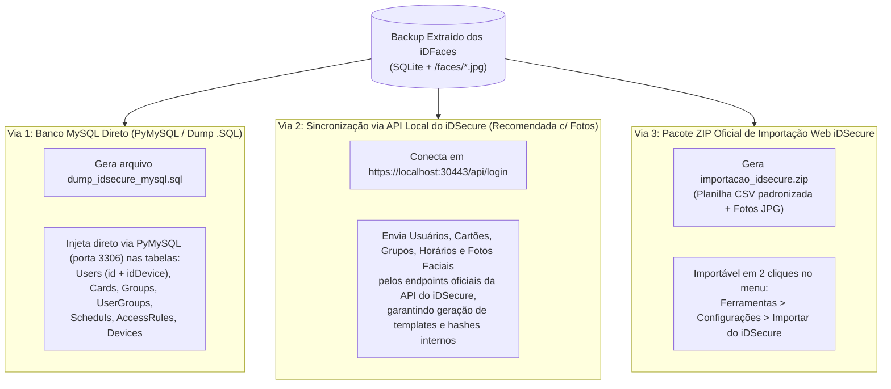

# TRD: Technical Requirements Document — Bot Backup Catraca (iDFace -> MySQL / iDSecure)

**Versão:** 2.0 (Com Suporte Nativo a MySQL e Restauração iDSecure)  
**Data:** 16 de Outubro de 2026  
**Status:** Especificação Técnica Aprovada para Desenvolvimento  
**Referência:** [PRD.md](file:///g:/Meu%20Drive/Projetos/Bot%20Backup%20Catraca/PRD.md)  
**Padrão Arquitetural:** Ecossistema `SCAN BOT Rede` (Python 3.10+ + Flet + HTTPX + SQLite + PyMySQL + PyInstaller).

---

## 1. Stack Tecnológica e Estratégia Dual-Database (SQLite + MySQL)

Quando o disco rígido do servidor do cliente queima, **não existe um servidor MySQL rodando** no momento em que o técnico chega com o notebook para extrair os dados das catracas. Portanto, o Bot operará com uma arquitetura **Dual-Database em 2 Estágios**:

1. **Estágio 1 — Coleta Portátil em Campo (SQLite + Gerador de Dump MySQL):**
   * Enquanto extrai os dados dos iDFaces, o bot salva tudo localmente em um arquivo `backup_controlid.sqlite` (usado para *checkpoint* de retomada caso o cabo oscile) e na pasta `/faces/`.
   * Ao concluir a extração, o bot **traduz e gera automaticamente**:
     * `dump_idsecure_mysql.sql`: Um script SQL completo compatível com o **MySQL do iDSecure**.
     * `importacao_idsecure.zip`: Planilha `.csv` + fotos `.jpg` empacotadas no formato nativo de importação em massa do iDSecure Web.
2. **Estágio 2 — Restauração Direta no Novo Servidor (`PyMySQL` + API `iDSecure`):**
   * Assim que o técnico reinstalar o Windows, o **MySQL** e o **iDSecure** novo, a Aba **"Restauração iDSecure / MySQL"** do Bot permite conectar diretamente ao MySQL recém-instalado (`localhost:3306`) via biblioteca `pymysql` e/ou à API local do iDSecure (`https://localhost:30443/api/...`) para repopular todo o banco e enviar as fotos faciais.

| Camada | Tecnologia / Biblioteca | Justificativa Técnica |
| :--- | :--- | :--- |
| **Linguagem Base** | Python 3.10+ | Tipagem moderna (`dataclasses`), `asyncio` e manipulação de arquivos/ZIP. |
| **Frontend Desktop** | `flet` (Flutter Engine) | UI reativa em Dark Mode com Abas (*1. Extrair das Catracas* / *2. Restaurar no iDSecure & MySQL*). |
| **Cliente HTTP / API** | `httpx` (Async) | Comunicação assíncrona tanto com os **iDFaces** (`http://IP/*.fcgi`) quanto com o servidor **iDSecure** (`https://localhost:30443/api/*`). |
| **Banco de Coleta (Staging)** | `sqlite3` (Nativo) | Persistência zero-config durante a coleta em campo e controle de checkpoints. |
| **Conector MySQL (Target)** | `pymysql` + `cryptography` | Driver 100% Python puro (compila perfeitamente no PyInstaller sem exigir DLLs externas do MySQL C Connector) para injetar dados direto no MySQL do iDSecure. |
| **Build & Distribuição** | `pyinstaller` | Empacotamento em executável único (`--onefile --windowed`). |

---

## 2. Arquitetura do Sistema e Estrutura de Diretórios

```text
Bot Backup Catraca/
│
├── PRD.md                              # Product Requirements Document
├── TRD.md                              # Technical Requirements Document (este arquivo)
├── backend/                            # Camada de Domínio, Rede, Extração e Banco
│   ├── core/
│   │   ├── scanner.py                  # Varredura de sub-rede / lista de IPs (padrão Scan Bot)
│   │   ├── detector.py                 # Identificação de dispositivos Control iD / iDFace
│   │   ├── network_utils.py            # Utilitários de IP/CIDR e parse de faixas
│   │   ├── idface_client.py            # Cliente HTTP assíncrono dedicado à API .fcgi do iDFace
│   │   ├── extractor.py                # Orquestrador de extração paginada + download de fotos c/ throttling
│   │   └── merger.py                   # Motor de consolidação e deduplicação multi-equipamento
│   ├── models/
│   │   ├── device.py                   # Dataclass do equipamento (IP, Serial, Modelo, Status Auth, Contagens)
│   │   └── backup_models.py            # Dataclasses dos objetos Control iD, mapeamento iDSecure e progresso
│   └── services/
│       ├── sqlite_storage.py           # Banco local de staging, checkpoints incrementais e queries
│       ├── mysql_idsecure_service.py   # Gerador de Dump (.sql) e Injetor Direto no MySQL do iDSecure (PyMySQL)
│       ├── idsecure_api_restorer.py    # Sincronizador via API REST do iDSecure (localhost:30443) + gerador ZIP
│       └── exporter_service.py         # Exportação JSON, organização de /faces/ e relatório de auditoria
│
├── frontend/                           # Camada Visual Desktop (Flet - Dark Mode)
│   ├── app.py                          # Controlador principal com navegação em Abas (Extrair / Restaurar)
│   ├── components/
│   │   ├── header.py                   # Topbar com branding "BACKUP BOT iDFace & iDSecure"
│   │   ├── connection_panel.py         # Input de IP/Faixa/CIDR, credenciais e botão "Buscar Equipamentos"
│   │   ├── device_selector.py          # Tabela de iDFaces descobertos com checkbox e pré-contagem
│   │   ├── progress_panel.py           # Barras de progresso por etapa (Objetos, Fotos X/Y, ETA) e Log
│   │   ├── restore_mysql_panel.py      # Aba de Restauração: Config MySQL (Host/Port/User/Pass/DB) + API iDSecure
│   │   └── audit_summary.py            # Cards de KPI pós-backup e botões de ação
│   └── styles/
│       └── theme.py                    # Paleta Dark Mode corporativa (consistente com Scan Bot)
│
├── backups/                            # Diretório padrão de saída (backup_YYYYMMDD_HHMMSS/)
├── tests/                              # Suíte de testes automatizados
│   ├── mock_idface_server.py           # Simulador HTTP de iDFace (login, load_objects, user_get_image)
│   ├── test_client_extractor.py        # Testes de paginação, retry e download de imagens
│   ├── test_merger_sqlite.py           # Testes de deduplicação multi-catraca e integridade do SQLite
│   ├── test_mysql_translator.py        # Testes de tradução iDFace -> Schema MySQL iDSecure (.sql e injeção)
│   └── test_e2e.py                     # Teste ponta a ponta
├── main.py                             # Entrypoint da aplicação
├── requirements.txt                    # Dependências (flet, httpx, pymysql, cryptography, reportlab, pyinstaller)
└── build.ps1                           # Script de automação de testes e build PyInstaller (.exe)
```

---

## 3. Mapeamento Técnico: API iDFace (`.fcgi`) $\rightarrow$ Banco MySQL do `iDSecure`

Este é o ponto mais crítico da engenharia do projeto: **o schema SQLite interno do aparelho iDFace tem diferenças importantes em relação ao schema MySQL do servidor iDSecure**. O módulo `mysql_idsecure_service.py` fará o **De-Para (ETL)** automático entre os dois padrões:

### 3.1 Diferenças Estruturais Críticas (iDFace vs. iDSecure MySQL)

1. **`users.id` (No Aparelho) vs. `Users.id` e `Users.idDevice` (No MySQL iDSecure):**
   * No **iDFace**, o usuário tem apenas `id` (ex: `id = 105`).
   * No **MySQL do iDSecure**, a tabela `Users` possui versionamento histórico: cada edição cria um novo `id` (`BIGINT AUTO_INCREMENT`), enquanto o ID fixo que vai para a catraca fica salvo na coluna **`idDevice`** (`INT`).
   * **Regra de Tradução:** Na criação do banco MySQL limpo para o iDSecure, inserimos `id = user.id` e **`idDevice = user.id`**, com `deleted = 0`, `inativo = 0` e `contingency = 1`. Assim, o iDSecure reconhece imediatamente os mesmos IDs que já estão nas catracas!
2. **Tabela de Cartões (`cards` no iDFace vs. `Cards` no MySQL iDSecure):**
   * No **iDFace**, o cartão possui `id`, `value` (inteiro 64-bit calculado: `area * 2^32 + codigo` ou Wiegand) e `user_id`.
   * No **MySQL do iDSecure**, a tabela `Cards` usa `id`, `id_user` (FK para `Users.id`), `code` (numérico), `value` (string) e `type` (`0`=ASK, `1`=Mifare, `2`=QR).
3. **Tabelas de Grupos e Departamentos (`groups` no iDFace vs. `Groups` e `UserGroups` no MySQL iDSecure):**
   * No **iDFace**: `groups` (`id`, `name`) e `user_groups` (`user_id`, `group_id`).
   * No **MySQL do iDSecure**:
     * Tabela `Groups`: `id`, `name`, `idType` (`0` = Departamento, `1` = Grupo, `2` = Empresa).
     * Tabela `UserGroups`: `id` (PK), `idUser` (FK), `idGroup` (FK).
4. **Horários e Regras de Acesso:**
   * No **iDFace**: `time_zones` + `time_spans` e `access_rules`.
   * No **MySQL do iDSecure**: `Scheduls` (horários em segundos desde 00:00 para cada dia da semana), `AccessRules`, `SchedulAccessRules`, `UserAccessRules`, `Areas`, `AreaAccessRules` e `Devices` (cadastro das catracas recuperadas com IP e Serial).

### 3.2 As 3 Vias de Restauração no iDSecure (`mysql_idsecure_service.py` & `idsecure_api_restorer.py`)

Como versões diferentes do iDSecure (Lite / Pro / Enterprise) aplicam triggers, hashes e cache em memória sobre o MySQL (especialmente para as fotos faciais), o Bot entregará **3 mecanismos complementares** na aba de Restauração para garantir 100% de sucesso em qualquer cenário de reinstalação:



#### Detalhamento do Modo 1: Geração de Dump e Injeção Direta MySQL (`mysql_idsecure_service.py`)
* **Geração Automática de Arquivo `.sql`:** Todo backup concluído gera automaticamente o arquivo `dump_idsecure_mysql.sql` compatível com MySQL 5.7 / 8.0 (`ENGINE=InnoDB DEFAULT CHARSET=utf8mb4`).
* **Injeção Direta via `PyMySQL`:**
  * Na interface gráfica, o técnico informa:
    * `Host`: `127.0.0.1` (ou IP do servidor novo)
    * `Porta`: `3306`
    * `Usuário`: `root` (ou usuário do banco do iDSecure)
    * `Senha`: senha do MySQL
    * `Database`: `idsecure` (com opção *"Criar banco caso não exista"* ou *"Injetar em banco já criado pelo instalador do iDSecure"*).
  * **Injeção Inteligente (Schema Introspection):** Antes de rodar os `INSERTs`, o conector consulta `INFORMATION_SCHEMA.COLUMNS` no banco MySQL do iDSecure recém-instalado para verificar exatamente quais colunas existem naquela versão específica do iDSecure, adaptando o `INSERT INTO Users (...)` dinamicamente para nunca quebrar por diferença de versão do iDSecure!

#### Detalhamento do Modo 2: Apontamento para API do iDSecure (`idsecure_api_restorer.py`)
* Quando o iDSecure já está instalado e rodando com seu banco MySQL conectado (`https://localhost:30443`), o Bot pode autenticar na API do próprio iDSecure e subir os dados + fotos faciais (`.jpg`), fazendo com que o próprio motor do iDSecure grave no MySQL e vincule os rostos na interface web sem precisar reiniciar o serviço.

#### Detalhamento do Modo 3: Pacote `importacao_idsecure.zip`
* Gera a planilha `.csv` (UTF-8 com BOM) contendo Nome, Matrícula, CPF/PIS, Grupo/Departamento, Cartão, Senha e Nome do Arquivo da Foto, compactada junto com as imagens `.jpg`, pronta para a ferramenta nativa de importação do iDSecure.

---

## 4. Especificação de Extração dos Terminais iDFace (`idface_client.py`)

1. **Login e Auto-Reautenticação:**
   * `POST http://{ip}/login.fcgi` $\rightarrow$ obtém `session`.
   * Se a sessão expirar durante o download de milhares de fotos, o cliente refaz o login automaticamente sem interromper a fila.
2. **Extração Paginada (`load_objects.fcgi`):**
   * `limit: 500`, `offset: N` para: `users`, `cards`, `groups`, `departments`, `user_groups`, `time_zones`, `time_spans`, `holidays`, `access_rules`, `group_access_rules`, `user_access_rules`, `access_rule_time_zones`, `portal_access_rules`, `pins`, `qrcodes`.
3. **Listagem e Download de Fotos com Deduplicação Pré-Download:**
   * Consulta `POST /user_list_images.fcgi` para saber quais `user_id` têm foto e qual o `timestamp`.
   * Baixa via `GET /user_get_image.fcgi?user_id={id}&session={token}` com semáforo limitado a 3 requisições simultâneas por IP.
   * Se o cliente tiver 4 catracas com os mesmos usuários, baixa cada foto apenas 1 vez (a mais recente), economizando até 75% do tempo.

---

## 5. Design da Interface Gráfica em 2 Abas (Flet UI)

A janela principal (`1240x820`, Dark Mode `#0F172A` / `#1E293B`) terá navegação superior dividida em **2 Abas Principais**:

### Aba 1: `1. Extrair Backup das Catracas (iDFace)`
* **Painel de Rede:** Faixa de IP / CIDR (com botão *"Puxar da Rede Local"* igual ao Scan Bot), Login/Senha dos iDFaces e botão **"Buscar Equipamentos"**.
* **Tabela de Dispositivos:** Lista os iDFaces encontrados na rede com Modelo, Serial, Status de Autenticação, Qtd. de Usuários e Qtd. de Fotos.
* **Progresso da Extração:** Barras de progresso separadas para Objetos/Regras e Fotos Faciais (`X de Y` + ETA) + Console de Logs ao vivo.
* **Saída Automática:** Gera `backup_controlid.sqlite`, `dump_idsecure_mysql.sql`, `importacao_idsecure.zip`, `backup_full.json` e pasta `/faces/`.

### Aba 2: `2. Restaurar no Servidor (MySQL / iDSecure)`
* **Seletor de Backup:** Escolhe qualquer pasta de backup gerada na Aba 1 (mostrando resumo de quantos usuários, cartões, grupos e fotos existem naquele backup).
* **Painel de Conexão MySQL (Padrão iDSecure):**
  * Campos: `Host` (`127.0.0.1`), `Porta` (`3306`), `Usuário` (`root`), `Senha`, `Nome do Banco` (`idsecure`).
  * Botão **"Testar Conexão MySQL"** (verifica se o banco do iDSecure novo está acessível e detecta as tabelas existentes).
  * Botão **"Injetar Dados no MySQL"** (popula `Users` com `idDevice` preservado, `Cards`, `Groups`, `UserGroups`, `Scheduls`, `AccessRules`, `Devices`).
* **Painel de Sincronização de Fotos / API iDSecure (`https://localhost:30443`):**
  * Campos: URL do iDSecure, Login e Senha web do iDSecure.
  * Botão **"Enviar Fotos e Sincronizar via API iDSecure"** + Atalho para o arquivo `importacao_idsecure.zip` e `dump_idsecure_mysql.sql`.
